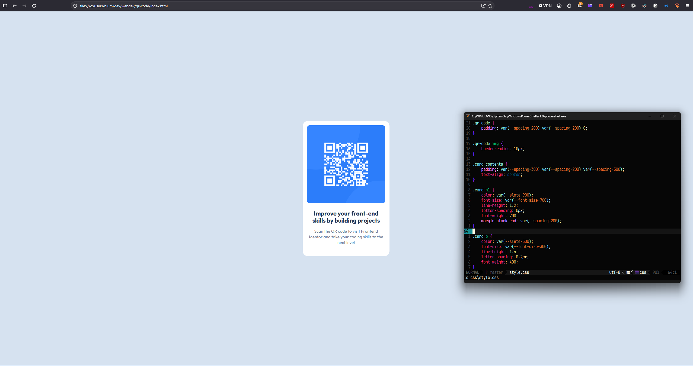

# Frontend Mentor - QR code component solution

This is a solution to the [QR code component challenge on Frontend Mentor](https://www.frontendmentor.io/challenges/qr-code-component-iux_sIO_H). Frontend Mentor challenges help you improve your coding skills by building realistic projects. 

## Table of contents

- [Overview](#overview)
  - [Screenshot](#screenshot)
  - [Links](#links)
- [My process](#my-process)
  - [Built with](#built-with)
  - [What I learned](#what-i-learned)
- [Author](#author)

**Note: Delete this note and update the table of contents based on what sections you keep.**

## Overview

### Screenshot



### Links

- [Solution URL](https://github.com/YuBlum/frontendmentor-qr-code)
- [Live Site URL](https://yublum.github.io/frontendmentor-qr-code/)

## My process

### Built with

- Semantic HTML5 markup
- CSS custom properties
- CSS Grid

### What I learned

Previously, I did not know how to organize my CSS values properly, but throughout this project, I came across custom properties, and things felt much more organized. I expected CSS to have something like constants and well... it does, I don't like the syntax, though.
```css
:root {
    --white:     hsl(0, 0%, 100%);
    --slate-300: hsl(212, 45%, 89%);
    --slate-500: hsl(216, 15%, 48%);
    --slate-900: hsl(218, 44%, 22%);

    --font-size-300: 0.9375rem;
    --font-size-700: 1.3750rem;

    --spacing-200: 16px;
    --spacing-300: 24px;
    --spacing-500: 40px;

    --font-family: "Outfit", sans-serif;
}
```

The project was very simple, too simple actually. There was not that much semantic HTML for me to work with. 

Overall, I didn't learn much about CSS with this project. I did learn, how to use Figma and follow a more professional workflow, though, and that was pretty valuable.

## Author

- Frontend Mentor - [@YuBlum](https://www.frontendmentor.io/profile/YuBlum)

